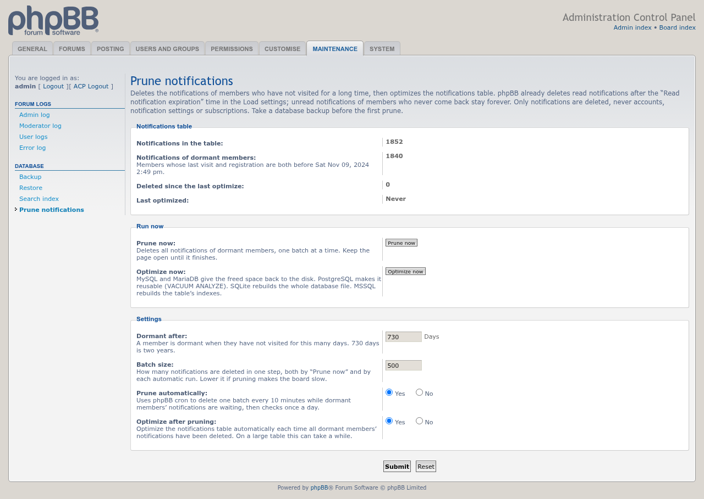
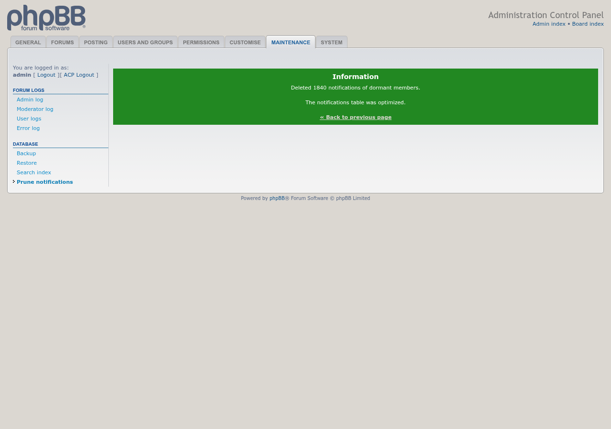

# Prune Notifications

 

Deletes the notifications of members who have not visited for a long time, then optimizes the notifications table.

phpBB already deletes read notifications after the **Read notification expiration** time. Unread notifications of members who never come back are kept forever, and on a large board they can fill most of the notifications table.

## Features

- Shows how many notifications belong to dormant members: those whose last visit and registration date are both older than a period you choose (two years by default). Members who registered but never logged in count too; new members don't.
- **Prune now** deletes them in batches with a progress page, so a large table doesn't time out.
- Optional automatic pruning through phpBB cron: one batch every 10 minutes while any are left, then a daily check. One admin log entry is written when the backlog is cleared.
- **Optimize now**, and an optional automatic optimize after each prune:
  - MySQL and MariaDB: `OPTIMIZE TABLE`, which gives the space back to the disk
  - PostgreSQL: `VACUUM ANALYZE`, which lets the table reuse the space
  - SQLite: `VACUUM` of the database file
  - MSSQL: rebuilds the table's indexes
- Only notifications are deleted. Accounts, notification settings and subscriptions are not touched, so a member who comes back starts with an empty notification list.

## Screenshots

<table>
<tr>
<td></td>
<td></td>
</tr>
</table>

Click an image for the full size. See the [screenshot gallery](docs/images/screenshots/README.md) for captions.

## Requirements

- phpBB 3.3.19 or later, including phpBB 4.0
- PHP 8.3.36 or later
- MySQL, MariaDB, PostgreSQL, SQLite or MSSQL

## Installation

1. Copy the extension to `/ext/phpbbmodders/prunenotifications`
2. In the Administration Control Panel, go to **Customise → Manage extensions**
3. Enable the **Prune Notifications** extension
4. Open **ACP → Maintenance → Database → Prune notifications**

Take a database backup before the first prune; deleted notifications can't be brought back.

## Optimizing on PostgreSQL and MSSQL

On PostgreSQL the extension runs `VACUUM ANALYZE`, which makes the freed space reusable without locking the table. `VACUUM FULL` would give the space back to the disk, but it locks the table for the whole run, so run it yourself at a quiet time if you need the disk space.

On MSSQL the extension rebuilds the table's indexes, which compacts the table inside the data file. Shrinking the data file itself is left to your database administrator.

## Uninstall

1. In the ACP, go to **Customise → Manage extensions** and disable **Prune Notifications**.
2. To remove its settings too, click **Delete data**, then delete the `/ext/phpbbmodders/prunenotifications` folder.

## Contributing

Contributions are welcome!

- **Bug reports**: [Open an issue](https://github.com/phpbbmodders/prunenotifications/issues).
- **Everything else** (questions, feature requests, ideas, general discussion): [Use Discussions](https://github.com/orgs/phpbbmodders/discussions), or the [community forum](https://www.phpbbmodders.com/community/).
- Pull requests are welcome for bug fixes or discussed features.

## Acknowledgments

- Based on a request by tigger333 and the SQL answer by JauntyM in [this phpBB.com support topic](https://www.phpbb.com/community/viewtopic.php?t=2676517).
- Code, tests and documentation written by [Claude](https://www.anthropic.com/claude).

## License

This extension is licensed under the **GNU General Public License v2.0**.

See [license.txt](license.txt) for more information.
