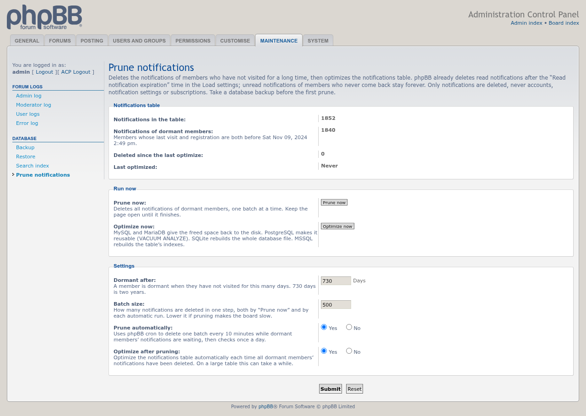
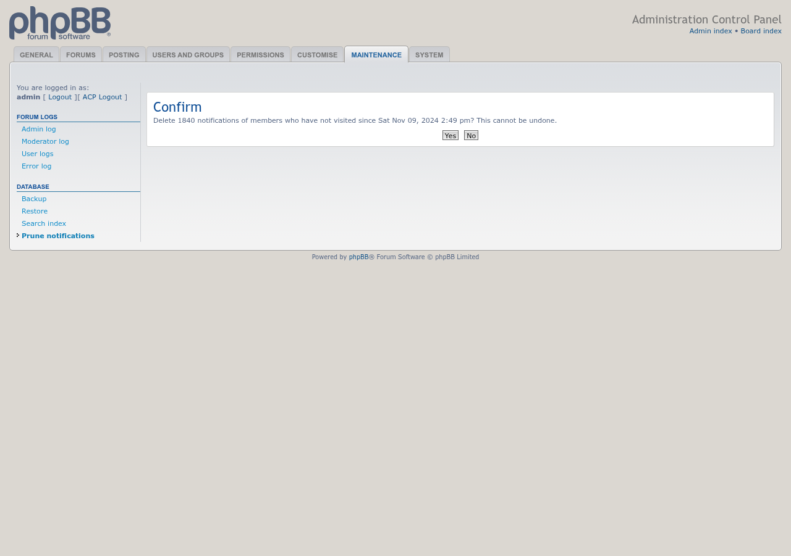
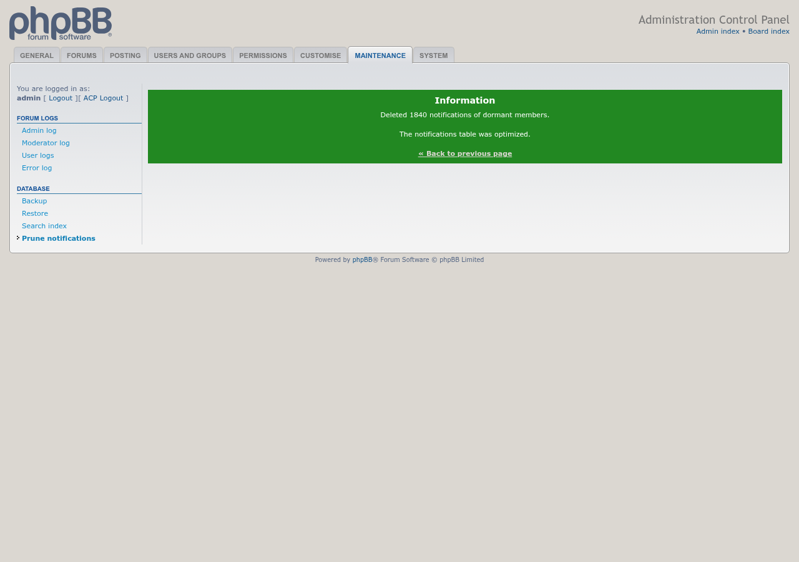

# Screenshots

Taken on a phpBB 3.3 test board with phpbb-release-tools' `screenshots.py`. Three members last visited two to five years ago and have 1,840 unread notifications between them; the admin has 12. Click an image for the full size.

## ACP page

**ACP → Maintenance → Database → Prune notifications**: how many notifications the table holds and how many belong to dormant members, the Prune now and Optimize now buttons, and the settings.

## Confirmation

Prune now asks first, naming the number of notifications and the cutoff date.

## Finished

After the last batch, with **Optimize after pruning** on, the table is optimized straight away.

